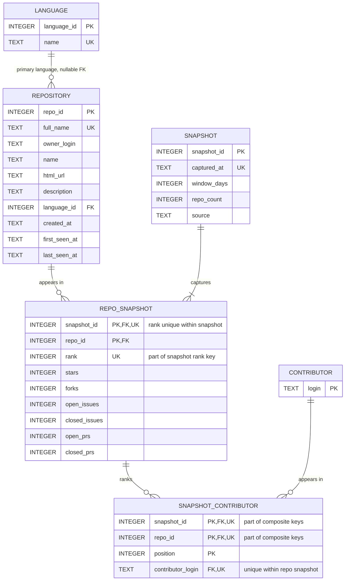

# Entity relationship diagram

| Relationship | Cardinality | Notes |
| --- | --- | --- |
| Language → Repository | One language to zero or more repositories | Each repository has zero or one detected primary language. The language FK is nullable. |
| Repository → Repo snapshot | One repository to zero or more observations | The associative entity resolves the many-to-many relationship between repositories and runs and holds the observed metrics. |
| Snapshot → Repo snapshot | One run to many observations when results exist | A successful empty search can produce a run with zero observations, as allowed by the schema. |
| Repo snapshot → Snapshot contributor | One observation to zero through five ranked contributors | The composite FK requires the repository to have appeared in that exact run. |
| Contributor → Snapshot contributor | One contributor to zero or more appearances | A login can appear for different repositories and runs. |

Composite constraints group the marked columns. `repo_snapshot` uses PK `(snapshot_id, repo_id)` and UK `(snapshot_id, rank)`. `snapshot_contributor` uses PK `(snapshot_id, repo_id, position)`, UK `(snapshot_id, repo_id, contributor_login)`, and FK `(snapshot_id, repo_id)`.

| Derived attribute | Rule | Location |
| --- | --- | --- |
| `health_status` | Green below 10 open issues, yellow from 10 through 50, red above 50. | `v_repo_snapshot_health` and matching live API logic |
| `star_gain` | Latest observed stars minus first observed stars for a repository. | `v_star_growth` |
| `health_score` | Rounded sum of equally weighted issue resolution and PR closure rates. An empty denominator gives a rate of 1. | `trending.py`, featured live API rows only |
